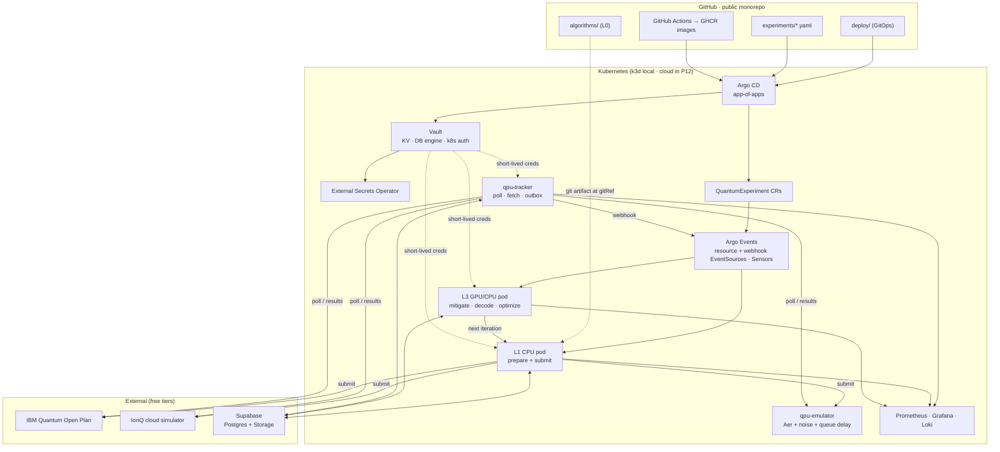
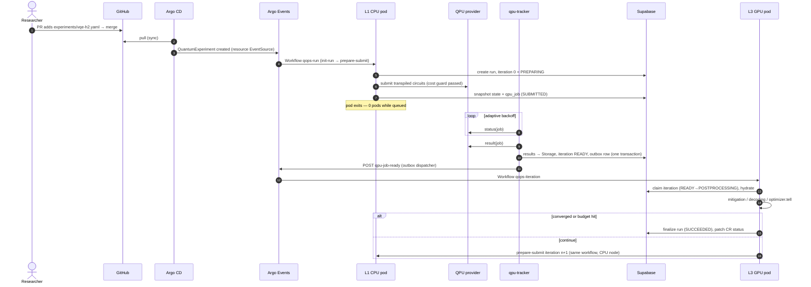
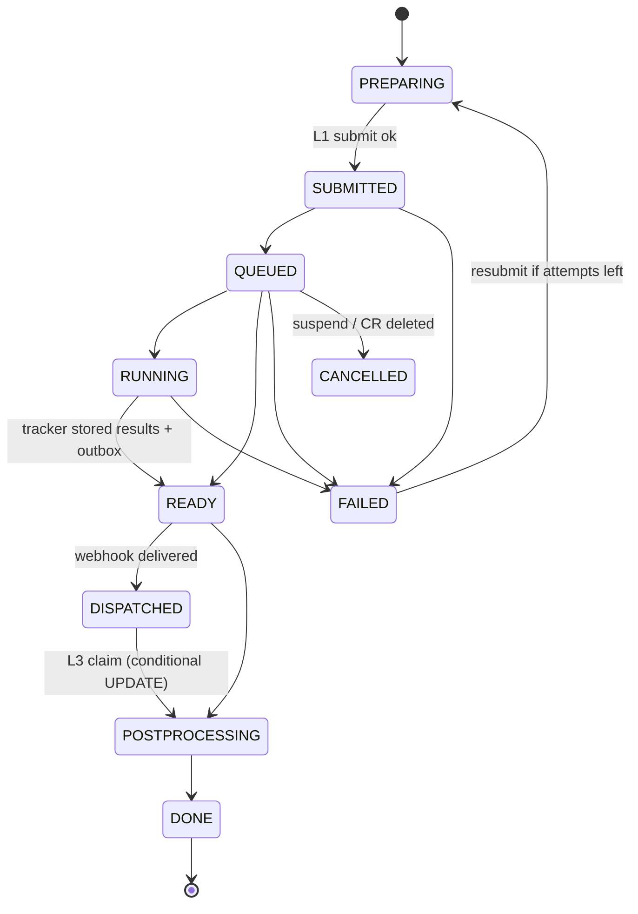

# QuantumOps — Architecture

> Status: **design approved, implementation not started.** Delivery is tracked in [ROADMAP.md](ROADMAP.md).
> Origin: [original blueprint](reference/original-blueprint.md). This document refines it, and
> [§17](#17-changes-from-the-original-blueprint) lists what changed and why.

---

## 1. Purpose

QuantumOps is a Kubernetes platform for **hybrid quantum-classical workloads** (VQE, QAOA, QEC experiments).
Researchers write plain Python/Qiskit; the platform runs it across three compute levels without anything sitting
idle while a job waits in a cloud QPU queue.

| Level | Where it runs | Responsibility |
|---|---|---|
| **L0 · Code** | Git repo (`algorithms/`) | Pure Qiskit. No decorators, no infrastructure imports |
| **L1 · CPU** | K8s CPU pool | Build circuits → mitigation/QEC *prepare* → transpile → cost guard → submit → **exit** |
| **L2 · QPU** | External quantum API | IBM Quantum · IonQ simulator · Braket local simulator · in-cluster QPU emulator |
| **L3 · GPU/CPU** | K8s GPU pool (CPU fallback) | Hydrate state → error mitigation + QEC decoding → optimizer step → finalize or loop to L1 |

### Constraints
- **Everything on Kubernetes**: local k3d first, cloud later (provider decided in P12).
- **Vault** holds every credential; nothing secret is ever in Git.
- **GitOps for everything**: platform, configuration, Vault config, DB schema, *and experiment runs*.
- **$0 budget.** Every component uses OSS or a free tier. Paid paths are blocked by default (see [§15](#15-free-tier-budget--paid-tripwires)).
- Scope: portfolio/learning grade with production patterns, a single research team, and a small footprint.

---

## 2. Design principles

1. **Zero-idle compute.** No pod exists while a job is queued on the QPU. The QPU wait is the boundary between workflows.
2. **Pure researcher code.** The platform infers the execution loop from a declared `kind`. Researcher code never imports the platform.
3. **State hydration.** Every iteration snapshot (algorithm state, optimizer state, seeds, circuits, raw results) is persisted
   before a pod exits, and rehydrated by the next pod.
4. **Event-driven, pull-based.** Git → Argo CD → custom resource → Argo Events → Workflow. Nothing on the internet needs to
   reach the cluster.
5. **Exactly-once processing.** Deterministic workflow names, a transactional outbox, and conditional DB state transitions.
6. **Interfaces over vendors.** Workers depend on "Postgres + S3" and a provider interface. Supabase and specific QPUs are
   pluggable implementations.
7. **Two gates on every paid path.** An admission policy and a runtime cost guard, both deny-by-default.

---

## 3. System overview



---

## 4. End-to-end flow



---

## 5. Component catalog

| Component | Namespace | Role | Tech |
|---|---|---|---|
| Argo CD | `argocd` | GitOps controller, app-of-apps, manages itself | Argo CD (Helm) |
| Vault | `vault` | Secrets, dynamic DB creds, k8s auth, audit | HashiCorp Vault OSS, Raft standalone, injector |
| vault-config-operator | `vault-config-operator` | Vault policies/roles/engines declared as CRs | redhat-cop vault-config-operator |
| External Secrets | `external-secrets` | Sync static Vault KV into K8s Secrets | ESO |
| Argo Workflows | `argo` | Runs L1/L3 pods as workflows | Argo Workflows (controller + server UI) |
| Argo Events | `argo-events` (controller) | EventBus, EventSources, Sensors (objects live in `qops-runs`) | Argo Events + NATS JetStream EventBus |
| qpu-tracker | `qops-system` | Poll in-flight QPU jobs, fetch results, outbox dispatch, `/metrics` | Python asyncio |
| qpu-emulator | `qops-system` | Free async "fake QPU": queue delay, noise, failure injection | FastAPI + Qiskit Aer (optional GPU) |
| Workflow pods | `qops-runs` | L1 CPU and L3 GPU/CPU executions | `qops-runtime-cpu` / `qops-runtime-gpu` images |
| Dev runs | `qops-dev` | CLI-submitted runs (not managed by Argo CD) | same as above |
| NVIDIA device plugin | `nvidia-device-plugin` | Expose `nvidia.com/gpu`, time-slicing ×4 | NVIDIA k8s-device-plugin |
| Monitoring | `monitoring` | Metrics, logs, dashboards, alerts | kube-prometheus-stack, Loki, Alloy |
| Policy | `kyverno` | Admission policies (P11) | Kyverno |
| State | external | Runs, iterations, jobs, outbox, usage, artifacts | Supabase Free (Postgres + Storage) |

---

## 6. L0 — researcher contract

Researcher code is a plain class in `algorithms/<name>/algorithm.py`. It has no base class, no decorator and no platform
import; the platform loads it by convention. The experiment's `kind` selects the loop:

| `kind` | Methods the class provides | Platform provides | Used by |
|---|---|---|---|
| `sampling` | `circuits(config) -> list[QuantumCircuit]`, optional `analyze(counts) -> dict` | submit, results, report | GHZ / Bell benchmarks |
| `variational` | `ansatz() -> QuantumCircuit` (parameterized), `hamiltonian() -> SparsePauliOp`, `initial_point() -> list[float]`, optional `exact_value()` | ask/tell optimizer loop, measurement grouping, expectation values, mitigation | VQE, QAOA |
| `qec-memory` | `code() -> {family, distance, rounds, basis}` *or* custom circuits + detector spec | syndrome circuits, Stim DEM, decoding, logical error rate | QEC experiments |

Example (VQE, 2-qubit parity-reduced H2 at 0.735 Å):

```python
# algorithms/vqe_h2/algorithm.py: pure Qiskit, nothing platform-specific
from qiskit.circuit.library import efficient_su2
from qiskit.quantum_info import SparsePauliOp


class Algorithm:
    def __init__(self, config: dict):
        self.reps = config.get("reps", 1)

    def ansatz(self):
        return efficient_su2(2, reps=self.reps)

    def hamiltonian(self):
        return SparsePauliOp.from_list([
            ("II", -1.052373245772859), ("IZ", 0.39793742484318045),
            ("ZI", -0.39793742484318045), ("ZZ", -0.01128010425623538),
            ("XX", 0.18093119978423156),
        ])

    def initial_point(self):
        return [0.0] * self.ansatz().num_parameters

    def exact_value(self):
        return -1.857275  # electronic ground-state energy (Ha)
```

Notes:
- The H2 Hamiltonian is hard-coded (qiskit-nature is unmaintained). QAOA uses Qiskit's QAOA ansatz from the circuit library.
- The platform always uses the **Sampler** primitive and computes expectation values in L3 from raw counts. This keeps data
  provider-neutral and lets our own mitigation run on it.

---

## 7. Trigger — the `QuantumExperiment` CRD

`qops.io/v1alpha1`, kind `QuantumExperiment`, short name `qx`. Experiments are committed to `experiments/` and synced by
Argo CD; Argo Events' **resource EventSource** watches the CRD and starts the run. No custom controller is needed.

```yaml
apiVersion: qops.io/v1alpha1
kind: QuantumExperiment
metadata:
  name: vqe-h2-emulator
spec:
  kind: variational
  algorithm:
    path: algorithms/vqe_h2
    gitRef: main            # resolved to a commit SHA at run start and pinned
    config: { reps: 1 }
  provider:
    name: emulator          # emulator | ibm | ionq | braket
    backend: fake_torino    # or least_busy
    shots: 4000
  stages:
    mitigation: [m3, { zne: { scales: [1, 3, 5], extrapolation: richardson } }]
    decoder: null           # pymatching | cudaq-qec (qec-memory only)
  optimizer: { name: spsa, maxiter: 40, seed: 7 }
  accelerator: auto         # auto | gpu | cpu
  budget: { maxIterations: 50, maxQpuSeconds: 120, allowPaid: false }
  suspend: false            # true → cancel run (also on CR deletion)
  runRevision: 1            # bump to re-run an unchanged experiment
status:                     # status subresource, written by the platform; Argo CD ignores it
  runId: 3f1c…
  phase: Active             # Pending | Active | Succeeded | Failed | Cancelled | BudgetExceeded
  iteration: 12
  bestValue: -1.8571
  qpuSeconds: 0
  lastError: ""
```

- **Code pinning:** workflow pods fetch `algorithms/` at the resolved commit through Argo Workflows' *git input
  artifact*, which makes every run reproducible.
- **Dev runs:** `qops run --cluster <path>` creates the CR in `qops-dev` and ships the uncommitted algorithm code as a
  ConfigMap. The same pipeline runs, but it isn't GitOps-managed.
- **Local runs:** `qops run --local <path>` runs the whole loop in-process against Aer, with no cluster involved.

---

## 8. Run lifecycle



- **Run states:** `PENDING → ACTIVE → SUCCEEDED | FAILED | CANCELLED | BUDGET_EXCEEDED`.
- **Iteration states** are shown above. Every transition is `UPDATE … SET status = :new WHERE id = :id AND status IN (:allowed) RETURNING *`.
  Zero rows returned means another actor already handled it, and the step exits as a no-op.
- **Idempotency layers:**
  1. Deterministic workflow names (`qx-<name>-g<generation>-r<runRevision>`, `qi-<run8>-i<n>`).
  2. The conditional claim above (the real guarantee).
  3. Outbox rows carry an event id, and the dispatcher retries until acknowledged.
- **Event flows:**

| Event | Source | Sensor action |
|---|---|---|
| `experiment-start` | resource EventSource (CR ADD/UPDATE) | Workflow `qops-run`: `init-run` → `prepare-submit(0)` |
| `qpu-job-ready` | webhook EventSource (tracker outbox) | Workflow `qops-iteration`: `postprocess(n)` → `finalize` or `prepare-submit(n+1)` |
| `qpu-job-failed` | webhook EventSource | Workflow `handle-failure`: resubmit up to N times, otherwise fail the run |
| `experiment-cancel` | resource EventSource (CR DELETE or `suspend: true`) | Workflow `cancel-run`: `provider.cancel` → CANCELLED |

---

## 9. L2 — provider adapter and cost guard

Package `qops_providers`; implementations register under the `qops.providers` entry-point group.

```python
class QuantumProvider(Protocol):
    name: str
    def capabilities(self, backend: str) -> Capabilities: ...   # paid, mid_circuit_measurement, per_shot_memory,
                                                                # max_shots, max_circuits_per_job
    def target(self, backend: str) -> Target: ...               # cached per backend per day (backend_cache)
    def estimate_cost(self, job: JobSpec) -> CostEstimate: ...  # qpu_seconds, usd
    def submit(self, job: JobSpec) -> ProviderJobRef: ...
    def status(self, ref: ProviderJobRef) -> JobStatus: ...     # QUEUED/RUNNING/DONE/FAILED/CANCELLED (+ queue info)
    def result(self, ref: ProviderJobRef) -> ResultSet: ...     # per-circuit bitarrays/counts + usage metrics
    def cancel(self, ref: ProviderJobRef) -> None: ...
```

| Provider | Backends | Free? | Purpose |
|---|---|---|---|
| `emulator` | Aer + fake-backend noise models (optionally Aer-GPU) | ✅ | dev, CI, chaos testing (configurable queue delay and failure rate), large QEC runs |
| `ibm` | IBM Quantum via qiskit-ibm-runtime SamplerV2 (job/batch mode; Open Plan has no sessions) | ✅ 10 QPU-min/month | real hardware |
| `ionq` | IonQ cloud simulator (with noise models) via qiskit-ionq | ✅ simulator only | second real remote async API |
| `braket` | Braket local simulator; managed sims/QPUs are paid | ✅ local only | adapter proven; paid devices blocked |

- QEC experiments require `per_shot_memory` and `mid_circuit_measurement`.
- **Cost guard** (runs in L1 before every submit):
  - **USD > 0:** the run is denied unless **both** `spec.budget.allowPaid: true` **and** Vault `kv/qops/policy.paid_enabled = true`.
  - **IBM Open Plan:** the run is denied if monthly `qpu_usage` plus the estimate would exceed 80% of 600 s.
  - **Run budget:** the run is denied if `spec.budget.maxQpuSeconds` would be exceeded.
  - A Kyverno policy (P11) independently rejects paid-provider CRs that lack an approval annotation.

---

## 10. L3 — stage plugins (error mitigation, QEC, optimizers)

Each stage has two hooks: `prepare()` runs in **L1** and adds circuits plus metadata, and `apply()` runs in **L3** and turns raw
results into corrected values. Stages register in the entry-point groups `qops.mitigators`, `qops.decoders` and `qops.optimizers`.

| Stage | L1 `prepare()` | L3 `apply()` | Accelerator |
|---|---|---|---|
| `m3` | readout calibration circuits | M3 quasi-probability correction | CPU |
| `zne` | gate folding at scale factors (Mitiq) | Richardson / exponential extrapolation | CPU |
| `cdr` | near-Clifford training circuits | **Aer-GPU** simulation of training set → regression | GPU (CPU fallback) |
| `pymatching` | QEC memory circuit + Stim circuit from same spec | DEM (noise from backend calibration) → MWPM decode → logical error rate | CPU |
| `cudaq-qec` | same | GPU decoder (`nv-qldpc-decoder`), batched shots; `ldpc` BP+OSD as CPU fallback | GPU |
| `spsa` | — (ask: next parameter points) | tell: update from energies; JSON state | CPU |
| `nevergrad` | ask | tell; pickled, versioned state | CPU |

- `accelerator: auto` schedules on the GPU pool when a `nvidia.com/gpu` is allocatable and otherwise uses the CPU image.
  The code path is the same (a cupy/numpy switch), and results must match within tolerance.
- **Where the GPU actually helps:** CDR training-set simulation, batch decoding of large shot counts, and reference
  noisy simulations. Small circuits are often just as fast on CPU, so the fallback is a first-class path, not a degraded one.
- QEC scope: repetition codes d=3/5/7 (map well onto IBM heavy-hex), d=3 rotated surface code on the emulator.

---

## 11. State layer (Supabase Free)

Connection goes through the **Supavisor pooler in session mode**, because direct connections on the free tier are IPv6-only.
In CI and offline dev the same code runs against in-cluster **Postgres + MinIO** (the `ci` overlay).

| Table | Key columns |
|---|---|
| `runs` | id, experiment, generation, run_revision, kind, spec (jsonb), git_sha, image_digests, status, best_value, created_at |
| `iterations` | run_id, n, status, state_ref, circuits_ref, results_ref, prep_meta (jsonb), metrics (jsonb), timestamps |
| `qpu_jobs` | iteration_id, provider, backend, provider_job_id, status, queue_info, next_poll_at, attempts, qpu_seconds, error |
| `outbox` | id, event_type, payload (jsonb), created_at, dispatched_at, attempts |
| `qpu_usage` | provider, month, qpu_seconds, usd |
| `backend_cache` | provider, backend, day, target_ref, calibration_ref |

- **RLS is enabled on every table with no policies**, so the public PostgREST/anon path is fully denied. Access is only
  through Vault-issued Postgres roles.
- **Artifacts** live in Storage bucket `qops-artifacts` under `runs/{run_id}/it-{n}/`:
  `state.json` (algorithm + optimizer state, RNG seeds, `schema_version`, git SHA, image digests) · `circuits.qpy` ·
  `prep_meta.json` · `results.npz.zst` · `post.json`.
- **Retention:** a CronJob prunes old artifacts to stay under 500 MB DB / 1 GB storage.
- **Migrations:** dbmate SQL in `db/migrations/`, applied by an Argo CD **PreSync hook Job** using the Vault `qops-migrator` role.
- **Supabase project and settings:** managed with OpenTofu (`infra/supabase/`) with native state encryption.

---

## 12. Secrets (Vault)

Vault OSS, Raft storage (standalone), agent injector enabled, audit device on (shipped to Loki).

**Bootstrap (the only imperative step):** `scripts/vault-init.sh` initializes and unseals Vault, stores the keys *outside* the
repo (`~/.qops/`), and enables k8s auth for vault-config-operator. Everything after that is declared as
vault-config-operator CRs in Git. `make unseal` is needed after a local restart; the cloud phase moves to KMS auto-unseal.

| Path / role | Type | Consumers |
|---|---|---|
| `kv/qops/providers/ibm`, `…/ionq`, `…/braket` | KV v2 | L1 (prepare/submit), tracker |
| `kv/qops/storage` | KV v2 (Supabase S3 keys) | L1, L3, tracker |
| `kv/qops/policy` | KV v2 (`paid_enabled=false`) | cost guard |
| `database/creds/qops-worker` | dynamic, TTL 1h / max 4h | L1, L3 pods (per-pod lease) |
| `database/creds/qops-tracker` | dynamic, renewed | tracker |
| `database/creds/qops-migrator` | dynamic, DDL | migration PreSync Job |
| `database/static-creds/qops-grafana-ro` | static, rotated | Grafana datasource |

**Delivery:**
- **ESO** syncs static KV into K8s Secrets for long-running services (tracker, emulator, Grafana).
- **Vault Agent, init-only mode,** gives each workflow pod its own DB lease. There is no sidecar, so pods still exit cleanly.
- The **tracker** runs Vault Agent as a sidecar so its lease keeps being renewed.

**Least privilege (k8s auth roles bound to ServiceAccounts):**

| ServiceAccount | QPU tokens | DB | Storage |
|---|---|---|---|
| `qops-runtime-cpu` (L1) | ✅ | ✅ | ✅ |
| `qops-runtime-gpu` (L3) | ❌ | ✅ | ✅ |
| `qops-tracker` | ✅ | ✅ | ✅ |

Secrets enter Vault only through `make seed-secrets` (interactive prompts). **gitleaks** runs in CI.

---

## 13. GitOps, repository layout, CI/CD

### Repository layout (monorepo)
```
algorithms/{ghz_benchmark,vqe_h2,qaoa_maxcut,qec_repetition,qec_surface}/   # L0 researcher code
experiments/*.yaml                         # QuantumExperiment CRs (GitOps run requests)
packages/                                  # uv workspace
  qops-core/       # models, contract loader, state serde, store (Postgres + S3), config
  qops-providers/  # adapter interface + emulator, ibm, ionq, braket
  qops-stages/     # mitigation, decoders, optimizers
  qops-runtime/    # workflow entrypoints: init-run, prepare-submit, postprocess, finalize, cancel
  qops-tracker/    # status tracker + outbox dispatcher + metrics
  qops-emulator/   # in-cluster async fake QPU
  qops-cli/        # `qops` CLI
images/{runtime-cpu,runtime-gpu,tracker,emulator}/Dockerfile
db/migrations/                             # dbmate SQL
deploy/
  bootstrap/                               # Argo CD values + root Application
  apps/                                    # app-of-apps Helm chart (one value set per env)
  platform/<component>/values.yaml         # upstream charts (multi-source Applications)
  charts/qops/                             # CRD, WorkflowTemplates, EventBus/EventSources/Sensors, tracker,
                                           # emulator, ExternalSecrets, Vault CRs, RBAC, NetworkPolicies,
                                           # dashboards, Kyverno policies
  envs/{local,ci}/                         # (+ envs/<cloud>/ in P12)
infra/
  local/                                   # k3d config, k3s-CUDA image
  github/  supabase/                       # OpenTofu (repo settings, Supabase project)
  <cloud>/                                 # OpenTofu (P12)
scripts/                                   # bootstrap, vault-init, unseal, seed-secrets
docs/                                      # ARCHITECTURE, ROADMAP, adr/, runbooks/, reference/
Makefile
```

### Argo CD
- The root Application (`deploy/bootstrap`) renders `deploy/apps` for the target env. Argo CD then takes over its own
  Helm release.
- **Sync waves:**

| Wave | Content |
|---|---|
| −2 | namespaces, CRDs |
| −1 | Vault |
| 0 | ESO, vault-config-operator, Argo Workflows, Argo Events, NVIDIA device plugin, monitoring |
| 1 | qops config: ClusterSecretStore, ExternalSecrets, Vault CRs, EventBus, EventSources, Sensors, WorkflowTemplates, QuantumExperiment CRD |
| 2 | DB migration PreSync Job, qpu-tracker, qpu-emulator |
| 3 | `experiments/` |

- Removing an experiment file prunes the CR, which cancels or archives the run.

### CI/CD (GitHub Actions, free for public repos)

| Workflow | Trigger | Steps |
|---|---|---|
| `ci.yml` | every PR | ruff, mypy, pytest (unit + local Aer runs), dbmate against a postgres service, helm lint, kubeconform, kyverno CLI tests, gitleaks |
| `images.yml` | push to `main` | buildx + GHA cache → GHCR `qops-runtime-cpu`, `qops-runtime-gpu`, `qops-tracker`, `qops-emulator` (tag `sha-<short>`) → Trivy → SBOM + cosign keyless (P11) → bot commit of tags into `deploy/envs/local` (GITHUB_TOKEN commits do not retrigger CI) |
| `e2e.yml` | nightly, manual, PR label | kind cluster + `ci` overlay → GHZ + short VQE on the emulator, duplicate-event and tracker-kill checks |

Renovate opens dependency-update PRs (charts, images, Python packages).

---

## 14. Cluster topology, observability, security

### Local cluster (k3d on Linux/WSL2 with an NVIDIA GPU, 32 GB+ RAM)

| Node | Labels / taints | Workloads |
|---|---|---|
| server-0 | control plane | k3s |
| agent `system` | `qops.io/pool=system` | Argo CD, Vault, Argo, ESO, monitoring |
| agent `cpu` | `qops.io/pool=cpu` | L1 pods, tracker, emulator |
| agent `gpu` | `qops.io/pool=gpu`, taint `nvidia.com/gpu=present:NoSchedule` | L3 pods; device plugin with time-slicing ×4 |

- **GPU image:** a custom k3s-CUDA image (`infra/local/k3s-cuda/`). Fallback is nvkind.
- **UIs:** exposed through Traefik at `*.qops.localhost` (Argo CD, Argo Workflows, Vault, Grafana).
- **Portability:** node pools are only labels and taints, so the cloud phase maps them onto real node pools without chart changes.

### Observability
- **Stack:** kube-prometheus-stack, Loki + Alloy, and Argo Workflows custom metrics. The tracker exposes `/metrics`, and
  Grafana queries Supabase through the read-only role.
- **Dashboards (as code):**
  - **Platform:** pod-seconds vs wall-clock per run. This is the **zero-idle KPI**.
  - **QPU:** queue-wait histograms, jobs by status, Open Plan quota gauge.
  - **Science:** VQE energy vs exact, QAOA approximation ratio, logical error rate vs distance, mitigation gain.
  - **Cost:** paid spend must stay at 0.
- **Alerts:**
  - IBM quota ≥ 80%.
  - Iteration READY but not dispatched for more than 10 min.
  - Workflow failures.
  - Vault sealed.
  - Supabase unreachable or paused.

### Security (hardened in P11)
- **Kyverno:**
  - Pod Security Standards "restricted".
  - Registry allowlist (`ghcr.io/michael-attias123/*` + pinned upstreams).
  - Required requests/limits.
  - cosign keyless `verifyImages`.
  - **Paid-provider gate.**
- Default-deny NetworkPolicies: L3 egress only to Vault and Supabase; L1 egress to Vault, Supabase and QPU APIs.
- Argo CD AppProjects scope what each app may deploy.
- Vault raft snapshot CronJob, plus runbooks for Vault sealed, emulator down, and Supabase paused.

---

## 15. Free-tier budget & paid tripwires

| Service | Free allowance used | Paid tripwire (blocked by default; needs explicit approval) |
|---|---|---|
| GitHub Actions / GHCR | unlimited for public repos | — |
| Supabase | 500 MB DB, 1 GB storage; pauses after 7 idle days | Pro plan, IPv4 add-on |
| IBM Quantum Open Plan | 10 QPU-min / month | Pay-as-you-go plan |
| IonQ | cloud simulator | QPU backends |
| AWS Braket | local simulator | managed simulators, QPUs |
| Cloud (P12, TBD) | e.g. OCI Always Free (OKE Basic, 4 OCPU / 24 GB Ampere A1) | managed control planes (EKS ≈ $73/month), any cloud GPU |
| Vault, Argo CD/Workflows/Events, ESO, Kyverno, Prometheus, Grafana, Loki, Mitiq, PyMatching, Stim, CUDA-Q | OSS | — |

---

## 16. Risks & spikes

| Risk | Phase | Mitigation |
|---|---|---|
| k3d GPU passthrough on WSL2 | P0 | spike first; fallback nvkind |
| Vault dynamic roles through Supavisor (`role.projectref`) | P4 | spike; fallback Vault static rotated roles |
| Qiskit 2.x compatibility of mthree / mitiq / qiskit-ionq / qiskit-braket-provider | P1 | pin matrix, compatibility tests |
| CUDA image size on free runners | P8 | free-disk-space step, layer caching |
| IBM queue times of hours | P6+ | expected (that's the point); tests use the emulator |
| Supabase auto-pause after inactivity | P4+ | alert + runbook |
| Cloud free-capacity limits (e.g. OCI A1 availability) | P12 | decided at phase start |

---

## 17. Changes from the original blueprint

1. **Pull-based trigger.** The blueprint had Argo CD "trigger" workflows, which it doesn't do well, and a local cluster
   can't receive GitHub webhooks. Experiments are now CRs synced by Argo CD and watched by Argo Events.
2. **Tracker as a small Deployment, not a CronJob or Edge Function.** A CronJob would pay Python/Qiskit startup every
   minute, and an Edge Function can't reach a local cluster. The tracker uses adaptive backoff and `FOR UPDATE SKIP LOCKED`,
   so it is multi-replica safe.
3. **Transactional outbox + conditional transitions** give exactly-once processing even when webhooks are lost or duplicated.
4. **Sampler everywhere**, with expectation values computed in L3. Data stays provider-neutral and our own mitigation runs on it.
5. **The QPU wait is the iteration boundary.** One workflow covers `postprocess(n) → prepare+submit(n+1)`, which supports
   iterative VQE/QAOA with zero idle pods.
6. **Supabase behind interfaces.** Workers need only Postgres + S3, and CI uses in-cluster Postgres + MinIO.
7. **Error correction made concrete:** mitigation (M3, ZNE, CDR) and QEC decoding (PyMatching, CUDA-Q QEC) as pluggable
   stages with a CPU fallback for every GPU path.
8. **Multi-provider adapter** with capability flags, plus a free in-cluster emulator that models queues and failures.
9. **GitOps extended** to Vault configuration (vault-config-operator) and DB schema (Argo CD PreSync migrations).
10. **Qiskit 2.x** instead of 1.x, and **$0 guardrails** throughout.
