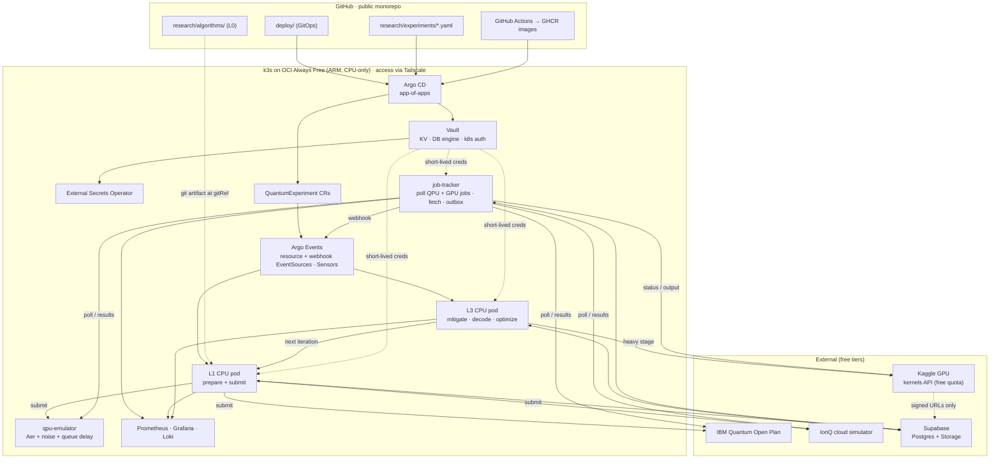
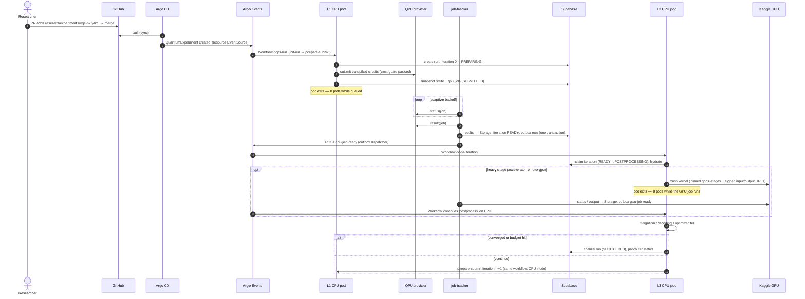
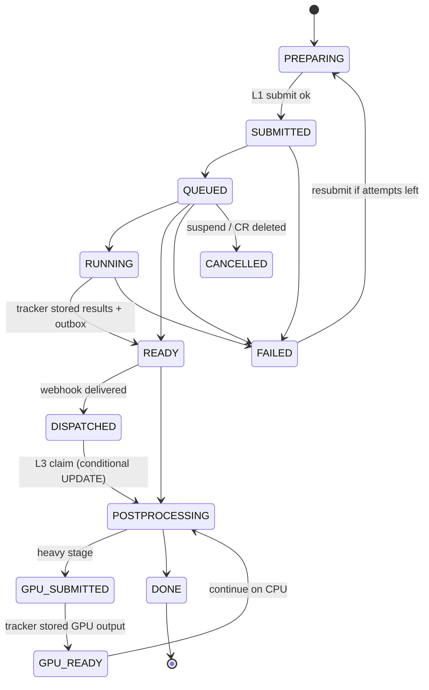

# QuantumOps — Architecture

> Status: **design approved, implementation not started.** Delivery is tracked in [ROADMAP.md](ROADMAP.md).
> Origin: [original blueprint](reference/original-blueprint.md). This document refines it, and
> [§17](#17-changes-from-the-original-blueprint) lists what changed and why.

---

## 1. Purpose

QuantumOps is a Kubernetes platform for **hybrid quantum-classical workloads** (VQE, QAOA, QEC experiments).
Researchers write plain Python/Qiskit; the platform runs it across three compute levels without anything sitting
idle while a job waits in a cloud QPU queue.

| Level | Where it runs | Responsibility |
|---|---|---|
| **L0 · Code** | Git repo (`research/algorithms/`) | Pure Qiskit. No decorators, no infrastructure imports |
| **L1 · CPU** | K8s CPU pool | Build circuits → mitigation/QEC *prepare* → transpile → cost guard → submit → **exit** |
| **L2 · QPU** | External quantum API | IBM Quantum · IonQ simulator · Braket local simulator · in-cluster QPU emulator |
| **L3 · GPU/CPU** | K8s CPU pool + **remote free GPU via API** (Kaggle) | Hydrate state → error mitigation + QEC decoding → optimizer step → finalize or loop to L1. Heavy stages are submitted to the remote GPU *exactly like a QPU job* |

### Constraints
- **Everything on Kubernetes**: one always-on **k3s cluster on Oracle Cloud Always Free** (ARM, $0), reachable from any of
  your computers over **Tailscale**. The cluster is CPU-only; GPU compute comes from **Kaggle through its API**.
- **Vault** holds every credential; nothing secret is ever in Git.
- **GitOps for everything**: platform, configuration, Vault config, DB schema, *and experiment runs*.
- **$0 budget.** Every component uses OSS or a free tier. Paid paths are blocked by default (see [§15](#15-free-tier-budget--paid-tripwires)).
- Scope: portfolio/learning grade with production patterns, a single research team, and a small footprint.

---

## 2. Design principles

1. **Zero-idle compute.** No pod exists while a job is queued on a remote QPU *or* remote GPU. Every remote wait is a
   boundary between workflows.
2. **Pure researcher code.** The platform infers the execution loop from a declared `kind`. Researcher code never imports the platform.
3. **State hydration.** Every iteration snapshot (algorithm state, optimizer state, seeds, circuits, raw results) is persisted
   before a pod exits, and rehydrated by the next pod.
4. **Event-driven, pull-based.** Git → Argo CD → custom resource → Argo Events → Workflow. Nothing on the internet needs to
   reach the cluster.
5. **Exactly-once processing.** Deterministic workflow names, a transactional outbox, and conditional DB state transitions.
6. **Interfaces over vendors.** Workers depend on "Postgres + S3" and a provider interface. Supabase and specific QPUs are
   pluggable implementations.
7. **Two gates on every paid path.** An admission policy and a runtime cost guard, both deny-by-default.

---

## 3. System overview



---

## 4. End-to-end flow



---

## 5. Component catalog

| Component | Namespace | Role | Tech |
|---|---|---|---|
| Argo CD | `argocd` | GitOps controller, app-of-apps, manages itself | Argo CD (Helm) |
| Vault | `vault` | Secrets, dynamic DB creds, k8s auth, audit | HashiCorp Vault OSS, Raft standalone, injector |
| vault-config-operator | `vault-config-operator` | Vault policies/roles/engines declared as CRs | redhat-cop vault-config-operator |
| External Secrets | `external-secrets` | Sync static Vault KV into K8s Secrets | ESO |
| Argo Workflows | `argo` | Runs L1/L3 pods as workflows | Argo Workflows (controller + server UI) |
| Argo Events | `argo-events` (controller) | EventBus, EventSources, Sensors (objects live in `qops-runs`) | Argo Events + NATS JetStream EventBus |
| job-tracker | `qops-system` | Poll in-flight remote QPU **and GPU** jobs, fetch results, outbox dispatch, `/metrics` | Python asyncio |
| qpu-emulator | `qops-system` | Free async "fake QPU": queue delay, noise, failure injection | FastAPI + Qiskit Aer (CPU) |
| Workflow pods | `qops-runs` | L1 and L3 executions (CPU) | `qops-runtime` image (multi-arch) |
| Dev runs | `qops-dev` | CLI-submitted runs (not managed by Argo CD) | same as above |
| Tailscale operator | `tailscale` | Expose UIs and the API privately on the tailnet (`*.ts.net`, HTTPS) | Tailscale Kubernetes operator |
| Monitoring | `monitoring` | Metrics, logs, dashboards, alerts | kube-prometheus-stack, Loki, Alloy |
| Policy | `kyverno` | Admission policies (P12) | Kyverno |
| State | external | Runs, iterations, jobs, outbox, usage, artifacts | Supabase Free (Postgres + Storage) |
| Remote GPU | external | Heavy L3 stages (GPU decoding, GPU simulation) | Kaggle kernels API (free weekly GPU quota) |

---

## 6. L0 — researcher contract

Researcher code is a plain class in `research/algorithms/<name>/algorithm.py`. It has no base class, no decorator and no platform
import; the platform loads it by convention (`qops_core.contract.load_algorithm`). Next to it, `algorithm.yaml` declares
the `kind` and default `config`; the platform calls `Algorithm(config)` with those defaults merged with any overrides.
The experiment's `kind` selects the loop:

| `kind` | Methods the class provides | Platform provides | Used by |
|---|---|---|---|
| `sampling` | `circuits() -> list[QuantumCircuit]`, optional `analyze(distributions: list[dict[str, float]]) -> dict` | transpile, submit, results, report | GHZ / Bell benchmarks |
| `variational` | `ansatz() -> QuantumCircuit` (parameterized), `hamiltonian() -> SparsePauliOp`, `initial_point() -> list[float]`, optional `exact_value()` | ask/tell optimizer loop, measurement grouping, expectation values, mitigation | VQE, QAOA |
| `qec-memory` | `code() -> {family, distance, rounds, basis}` *or* custom circuits + detector spec | syndrome circuits, Stim DEM, decoding, logical error rate | QEC experiments (P10) |

`distributions` are outcome probabilities keyed by bitstring (Qiskit order, clbit 0 rightmost), one per circuit, in
order. Providers return counts or, on exact simulators, exact probabilities; the platform normalizes both
(`qops_core.models.CircuitResult`).

Example (VQE, 2-qubit parity-reduced H2 at 0.735 Å; the real file is `research/algorithms/vqe_h2/algorithm.py`):

```python
# research/algorithms/vqe_h2/algorithm.py: pure Qiskit, nothing platform-specific
from qiskit.circuit.library import real_amplitudes
from qiskit.quantum_info import SparsePauliOp


class Algorithm:
    def __init__(self, config: dict) -> None:
        self.reps = int(config.get("reps", 2))

    def ansatz(self):
        return real_amplitudes(2, reps=self.reps)

    def hamiltonian(self):
        return SparsePauliOp.from_list([
            ("II", -1.052373245772859), ("IZ", 0.39793742484318045),
            ("ZI", -0.39793742484318045), ("ZZ", -0.01128010425623538),
            ("XX", 0.18093119978423156),
        ])

    def initial_point(self):
        return [0.1] * self.ansatz().num_parameters

    def exact_value(self):
        return -1.8572750302023795  # electronic ground-state energy (Ha)
```

```yaml
# research/algorithms/vqe_h2/algorithm.yaml
name: vqe_h2
kind: variational
config:
  reps: 2
```

Notes:
- The H2 Hamiltonian is hard-coded (qiskit-nature is unmaintained). QAOA uses Qiskit's QAOA ansatz from the circuit library.
- The platform always uses the **Sampler** primitive and computes expectation values in L3 from raw counts. This keeps data
  provider-neutral and lets our own mitigation run on it.
- `qops run --local <path>` runs the whole loop in-process on Aer (`exact` or `sampler` backend), writing `state.json`
  after every iteration; `qops run --resume <state.json>` continues with an identical trajectory.
  `qops new algorithm <name> --kind …` scaffolds a valid algorithm.

---

## 7. Trigger — the `QuantumExperiment` CRD

`qops.io/v1alpha1`, kind `QuantumExperiment`, short name `qx`. Experiments are committed to `research/experiments/` and synced by
Argo CD; Argo Events' **resource EventSource** watches the CRD and starts the run. No custom controller is needed.

```yaml
apiVersion: qops.io/v1alpha1
kind: QuantumExperiment
metadata:
  name: vqe-h2-emulator
spec:
  kind: variational
  algorithm:
    path: research/algorithms/vqe_h2
    gitRef: main            # resolved to a commit SHA at run start and pinned
    config: { reps: 1 }
  provider:
    name: emulator          # emulator | ibm | ionq | braket
    backend: fake_torino    # or least_busy
    shots: 4000
  stages:
    mitigation: [m3, { zne: { scales: [1, 3, 5], extrapolation: richardson } }]
    decoder: null           # pymatching | cudaq-qec (qec-memory only)
  optimizer: { name: spsa, maxiter: 40, seed: 7 }
  accelerator: auto         # auto | remote-gpu | cpu
  budget: { maxIterations: 50, maxQpuSeconds: 120, allowPaid: false }
  suspend: false            # true → cancel run (also on CR deletion)
  runRevision: 1            # bump to re-run an unchanged experiment
status:                     # status subresource, written by the platform; Argo CD ignores it
  runId: 3f1c…
  phase: Active             # Pending | Active | Succeeded | Failed | Cancelled | BudgetExceeded
  iteration: 12
  bestValue: -1.8571
  qpuSeconds: 0
  lastError: ""
```

- **Code pinning:** workflow pods fetch `research/algorithms/` at the resolved commit through Argo Workflows' *git input
  artifact*, which makes every run reproducible.
- **Dev runs:** `qops run --cluster <path>` creates the CR in `qops-dev` and ships the uncommitted algorithm code as a
  ConfigMap. The same pipeline runs, but it isn't GitOps-managed.
- **Local runs:** `qops run --local <path>` runs the whole loop in-process against Aer, with no cluster involved.

---

## 8. Run lifecycle



- **Run states:** `PENDING → ACTIVE → SUCCEEDED | FAILED | CANCELLED | BUDGET_EXCEEDED`.
- **Iteration states** are shown above. Every transition is `UPDATE … SET status = :new WHERE id = :id AND status IN (:allowed) RETURNING *`.
  Zero rows returned means another actor already handled it, and the step exits as a no-op.
- **Idempotency layers:**
  1. Deterministic workflow names (`qx-<name>-g<generation>-r<runRevision>`, `qi-<run8>-i<n>`).
  2. The conditional claim above (the real guarantee).
  3. Outbox rows carry an event id, and the dispatcher retries until acknowledged.
- **Event flows:**

| Event | Source | Sensor action |
|---|---|---|
| `experiment-start` | resource EventSource (CR ADD/UPDATE) | Workflow `qops-run`: `init-run` → `prepare-submit(0)` |
| `qpu-job-ready` | webhook EventSource (tracker outbox) | Workflow `qops-iteration`: `postprocess(n)` → `finalize` or `prepare-submit(n+1)` |
| `gpu-job-ready` | webhook EventSource (tracker outbox) | Workflow `qops-iteration` resumes `postprocess(n)` with GPU output |
| `qpu-job-failed` / `gpu-job-failed` | webhook EventSource | Workflow `handle-failure`: resubmit up to N times (GPU jobs may fall back to CPU), otherwise fail the run |
| `experiment-cancel` | resource EventSource (CR DELETE or `suspend: true`) | Workflow `cancel-run`: `provider.cancel` → CANCELLED |

---

## 9. L2 — provider adapter and cost guard

Package `qops_providers`; implementations register under the `qops.providers` entry-point group.

```python
class QuantumProvider(Protocol):
    name: str
    def capabilities(self, backend: str) -> Capabilities: ...   # paid, mid_circuit_measurement, per_shot_memory,
                                                                # max_shots, max_circuits_per_job
    def target(self, backend: str) -> Target: ...               # cached per backend per day (backend_cache)
    def estimate_cost(self, job: JobSpec) -> CostEstimate: ...  # qpu_seconds, usd
    def submit(self, job: JobSpec) -> ProviderJobRef: ...
    def status(self, ref: ProviderJobRef) -> JobStatus: ...     # QUEUED/RUNNING/DONE/FAILED/CANCELLED (+ queue info)
    def result(self, ref: ProviderJobRef) -> ResultSet: ...     # per-circuit bitarrays/counts + usage metrics
    def cancel(self, ref: ProviderJobRef) -> None: ...
```

| Provider | Backends | Free? | Purpose |
|---|---|---|---|
| `emulator` | Aer + fake-backend noise models | ✅ | dev, CI, chaos testing (configurable queue delay and failure rate), large QEC runs |
| `ibm` | IBM Quantum via qiskit-ibm-runtime SamplerV2 (job/batch mode; Open Plan has no sessions) | ✅ 10 QPU-min/month | real hardware |
| `ionq` | IonQ cloud simulator (with noise models) via qiskit-ionq | ✅ simulator only | second real remote async API |
| `braket` | Braket local simulator; managed sims/QPUs are paid | ✅ local only | adapter proven; paid devices blocked |

- QEC experiments require `per_shot_memory` and `mid_circuit_measurement`.
- **Cost guard** (runs in L1 before every submit):
  - **USD > 0:** the run is denied unless **both** `spec.budget.allowPaid: true` **and** Vault `kv/qops/policy.paid_enabled = true`.
  - **IBM Open Plan:** the run is denied if monthly `qpu_usage` plus the estimate would exceed 80% of 600 s.
  - **Run budget:** the run is denied if `spec.budget.maxQpuSeconds` would be exceeded.
  - A Kyverno policy (P12) independently rejects paid-provider CRs that lack an approval annotation.

---

## 10. L3 — stage plugins (error mitigation, QEC, optimizers)

Each stage has two hooks: `prepare()` runs in **L1** and adds circuits plus metadata, and `apply()` runs in **L3** and turns raw
results into corrected values. Stages register in the entry-point groups `qops.mitigators`, `qops.decoders` and `qops.optimizers`.

| Stage | L1 `prepare()` | L3 `apply()` | Accelerator |
|---|---|---|---|
| `m3` | readout calibration circuits | M3 quasi-probability correction | CPU |
| `zne` | gate folding at scale factors (Mitiq) | Richardson / exponential extrapolation | CPU |
| `cdr` | near-Clifford training circuits | simulation of training set → regression (Aer-GPU / cuStateVec on Kaggle when large) | CPU or remote GPU |
| `pymatching` | QEC memory circuit + Stim circuit from same spec | DEM (noise from backend calibration) → MWPM decode → logical error rate | CPU |
| `cudaq-qec` | same | GPU decoder (`nv-qldpc-decoder`), batched shots, run on Kaggle; `ldpc` BP+OSD as CPU fallback | remote GPU |
| `spsa` | — (ask: next parameter points) | tell: update from energies; JSON state | CPU |
| `nevergrad` | ask | tell; pickled, versioned state | CPU |

- **Routing:** each stage declares `accelerator: cpu | remote-gpu | auto`. `auto` keeps small work on cluster CPU (a 1–2 min
  Kaggle startup would dominate a VQE iteration) and sends large work (thresholds on shots/qubits/training-set size)
  to the remote GPU. The code path is the same (a cupy/numpy switch), and results must match within tolerance.
- **Where the GPU actually helps:** CDR training-set simulation, batch decoding of large shot counts, and large noisy
  reference simulations. The CPU path is a first-class path, not a degraded one.
- QEC scope: repetition codes d=3/5/7 (map well onto IBM heavy-hex), d=3 rotated surface code on the emulator.

### 10.1 Remote GPU provider (Kaggle), used like a QPU

The GPU is treated as a **remote accelerator provider**, with the same interface as the QPU adapter
(`capabilities`, `estimate_cost`, `submit`, `status`, `result`, `cancel`) in `qops_providers.gpu`:

| Provider | Free? | Notes |
|---|---|---|
| `kaggle` | ✅ ~30 GPU-hours/week (T4 / P100), no card | `kernels push` → `kernels status` → `kernels output`; phone verification needed for GPU; ~1–2 min startup |
| `local-cpu` | ✅ | runs the same stage in-cluster; the fallback for every GPU stage |

- **Job contents:** a private Kaggle kernel script that `pip install`s `qops-stages` from this public repo **at the pinned git
  SHA**, downloads its input from a **1-hour Supabase signed URL**, and uploads its output to a **signed upload URL**.
  Kaggle's base image already ships CUDA, cupy and torch.
- **Least privilege:** the remote job never holds DB, Vault or QPU credentials, only the two signed URLs. The Kaggle API
  key is in Vault (`kv/qops/providers/kaggle`).
- **Quota guard:** a `gpu_usage` table tracks weekly GPU-hours. Submission is refused at ≥ 80% of the weekly quota, and
  `auto` falls back to CPU.
- **Tracking:** the same job-tracker polls Kaggle jobs (`remote_jobs.kind = gpu`) and emits `gpu-job-ready` through the outbox.

---

## 11. State layer (Supabase Free)

Connection goes through the **Supavisor pooler in session mode**, because direct connections on the free tier are IPv6-only.
In CI and offline dev the same code runs against in-cluster **Postgres + MinIO** (the `ci` overlay).

| Table | Key columns |
|---|---|
| `runs` | id, experiment, generation, run_revision, kind, spec (jsonb), git_sha, image_digests, status, best_value, created_at |
| `iterations` | run_id, n, status, state_ref, circuits_ref, results_ref, prep_meta (jsonb), metrics (jsonb), timestamps |
| `remote_jobs` | iteration_id, kind (qpu/gpu), provider, backend, provider_job_id, status, queue_info, next_poll_at, attempts, qpu_seconds, error |
| `outbox` | id, event_type, payload (jsonb), created_at, dispatched_at, attempts |
| `qpu_usage` | provider, month, qpu_seconds, usd |
| `gpu_usage` | provider, week, gpu_hours |
| `backend_cache` | provider, backend, day, target_ref, calibration_ref |

- **RLS is enabled on every table with no policies**, so the public PostgREST/anon path is fully denied. Access is only
  through Vault-issued Postgres roles.
- **Artifacts** live in Storage bucket `qops-artifacts` under `runs/{run_id}/it-{n}/`:
  `state.json` (algorithm + optimizer state, RNG seeds, `schema_version`, git SHA, image digests) · `circuits.qpy` ·
  `prep_meta.json` · `results.npz.zst` · `post.json`.
- **Retention:** a CronJob prunes old artifacts to stay under 500 MB DB / 1 GB storage.
- **Migrations:** dbmate SQL in `packages/qops-core/migrations/`, applied by an Argo CD **PreSync hook Job** using the Vault `qops-migrator` role.
- **Supabase project and settings:** managed with OpenTofu (`infra/supabase/`) with native state encryption.

---

## 12. Secrets (Vault)

Vault OSS, Raft storage (standalone), agent injector enabled, audit device on (shipped to Loki).

**Bootstrap (the only imperative step):** `deploy/bootstrap/scripts/vault-init.sh` initializes and unseals Vault, stores the keys *outside* the
repo (`~/.qops/`), and enables k8s auth for vault-config-operator. Everything after that is declared as
vault-config-operator CRs in Git. Vault uses **OCI KMS auto-unseal** (free tier), so no laptop is needed after a restart;
the fallback is `make unseal` over Tailscale.

| Path / role | Type | Consumers |
|---|---|---|
| `kv/qops/providers/ibm`, `…/ionq`, `…/braket` | KV v2 | L1 (prepare/submit), tracker |
| `kv/qops/providers/kaggle` | KV v2 | L3 (submit GPU job), tracker |
| `kv/qops/storage` | KV v2 (Supabase S3 keys) | L1, L3, tracker |
| `kv/qops/policy` | KV v2 (`paid_enabled=false`) | cost guard |
| `database/creds/qops-worker` | dynamic, TTL 1h / max 4h | L1, L3 pods (per-pod lease) |
| `database/creds/qops-tracker` | dynamic, renewed | tracker |
| `database/creds/qops-migrator` | dynamic, DDL | migration PreSync Job |
| `database/static-creds/qops-grafana-ro` | static, rotated | Grafana datasource |

**Delivery:**
- **ESO** syncs static KV into K8s Secrets for long-running services (tracker, emulator, Grafana).
- **Vault Agent, init-only mode,** gives each workflow pod its own DB lease. There is no sidecar, so pods still exit cleanly.
- The **tracker** runs Vault Agent as a sidecar so its lease keeps being renewed.

**Least privilege (k8s auth roles bound to ServiceAccounts):**

| ServiceAccount | QPU tokens | Kaggle key | DB | Storage |
|---|---|---|---|---|
| `qops-l1` | ✅ | ❌ | ✅ | ✅ |
| `qops-l3` | ❌ | ✅ | ✅ | ✅ |
| `job-tracker` | ✅ | ✅ | ✅ | ✅ |
| remote Kaggle job | ❌ | ❌ | ❌ | signed URLs only |

Secrets enter Vault only through `make seed-secrets` (interactive prompts). **gitleaks** runs in CI.

---

## 13. GitOps, repository layout, CI/CD

### Repository layout (monorepo)
Folders are created **just in time** by the phase that puts real files in them; there are no empty placeholders
([ADR 0009](adr/0009-repository-layout-and-branches.md)). ✅ = exists today; otherwise the phase that creates it.

```
research/                                  ✅ what researchers touch
  algorithms/<name>/                       ✅ L0 pure-Qiskit code (ghz_benchmark, vqe_h2; qaoa_maxcut P8; qec_* P10)
  experiments/*.yaml                       P6  QuantumExperiment CRs (GitOps run requests)
packages/                                  ✅ uv workspace; each service owns its Dockerfile (P6)
  qops-core/                               ✅ models, contract, state; store (Postgres + S3) P5; migrations/ (dbmate) P5
  qops-providers/                          ✅ adapter interface + aer; emulator P6; ibm/ionq/braket P7; gpu/kaggle/ P9
  qops-stages/                             ✅ optimizers, measurement; mitigation P9; decoders P10
  qops-runtime/                            ✅ local loop; workflow entrypoints P6
  qops-tracker/  qops-emulator/            P6  remote-job tracker + outbox, async fake QPU
  qops-cli/                                ✅ `qops` CLI
deploy/                                    P3  everything Argo CD syncs
  bootstrap/                               P3  Argo CD values + root Application; scripts/ (vault-init, seed-secrets) P4
  apps/                                    P3  app-of-apps chart (one value set per env)
  platform/<component>/values.yaml         P3+ upstream charts (multi-source Applications)
  charts/qops/                             P6  CRD, WorkflowTemplates, Events, tracker, emulator, ExternalSecrets,
                                               Vault CRs, RBAC, NetworkPolicies, dashboards, Kyverno policies
  envs/{oci,ci}/                           P3  oci = the real cluster, ci = kind in GitHub Actions
infra/                                         OpenTofu
  ci/kind-config.yaml                      ✅ kind cluster for e2e tests (P6)
  oci/                                     P2  VCN, 1× A1 VM, k3s cloud-init, Tailscale, KMS
  github/                                  P3  repo settings, branch protection
  supabase/                                P5  Supabase project
tests/                                     ✅ repo-wide guards: architecture, algorithm contract, pin matrix
docs/                                      ✅ README index, ARCHITECTURE, ROADMAP, adr/, phases/, reference/; runbooks/ P2
make/                                      ✅ make includes: dev.mk, verify.mk; infra.mk P2, deploy.mk P3 …
.github/                                   ✅ workflows/, CONTRIBUTING.md, renovate.json, linters/
Makefile  pyproject.toml  uv.lock  README.md
```

### Argo CD
- The root Application (`deploy/bootstrap`) renders `deploy/apps` for the target env. Argo CD then takes over its own
  Helm release.
- **Sync waves:**

| Wave | Content |
|---|---|
| −2 | namespaces, CRDs |
| −1 | Vault |
| 0 | ESO, vault-config-operator, Argo Workflows, Argo Events, Tailscale operator, monitoring |
| 1 | qops config: ClusterSecretStore, ExternalSecrets, Vault CRs, EventBus, EventSources, Sensors, WorkflowTemplates, QuantumExperiment CRD |
| 2 | DB migration PreSync Job, job-tracker, qpu-emulator |
| 3 | `research/experiments/` |

- Removing an experiment file prunes the CR, which cancels or archives the run.

### CI/CD (GitHub Actions, free for public repos)

| Workflow | Trigger | Steps |
|---|---|---|
| `ci.yml` | every PR | ruff, mypy, pytest (unit + local Aer runs), dbmate against a postgres service, helm lint, kubeconform, kyverno CLI tests, gitleaks |
| `images.yml` | push to `main` | buildx (native `ubuntu-24.04-arm` + `ubuntu-latest` runners, multi-arch manifest) + GHA cache → GHCR `qops-runtime`, `qops-tracker`, `qops-emulator` (tag `sha-<short>`) → Trivy → SBOM + cosign keyless (P12) → bot commit of tags into `deploy/envs/oci` (GITHUB_TOKEN commits do not retrigger CI) |
| `e2e.yml` | nightly, manual, PR label | kind cluster + `ci` overlay → GHZ + short VQE on the emulator, duplicate-event and tracker-kill checks |

Renovate opens dependency-update PRs (charts, images, Python packages).

---

## 14. Cluster topology, observability, security

### Cluster (k3s on OCI Always Free, provisioned by OpenTofu in `infra/oci/`)

| Node | Shape | Labels | Workloads |
|---|---|---|---|
| `qops-node` | VM.Standard.A1.Flex, **2 OCPU / 12 GB** (the whole Always Free A1 allowance) | `qops.io/pool=cpu` | everything: k3s, platform components, L1/L3 pods, job-tracker, emulator |

A single node, because Oracle reportedly halved Always Free A1 to 2 OCPU / 12 GB in mid-2026 ([ADR 0008](adr/0008-single-node-a1-cluster.md)).
Platform components carry no node selector; compute pods select `qops.io/pool=cpu`, so more nodes or pools can be added
later without chart changes.

- **Access:** the VMs have **no public inbound ports**. SSH and the k3s API are reachable only over **Tailscale**
  (free personal plan). UIs (Argo CD, Argo Workflows, Vault, Grafana) are exposed by the Tailscale Kubernetes operator at
  `*.ts.net` with HTTPS. Any of your computers needs only `tailscale`, `kubectl` and `uv` (`make kubeconfig`).
- **k3s rather than OKE**, so the cluster stays portable and other nodes can join over the tailnet later.
- **OpenTofu state:** OCI Object Storage (Always Free, S3-compatible backend) with OpenTofu state encryption. OCI API keys
  and Tailscale auth keys are sensitive variables or env vars, never committed.
- **Footprint budget (12 GB):** k3s ~1 GB · Argo CD ~1 GB · Vault + ESO + vault-config-operator ~0.6 GB · Argo Workflows +
  Events + NATS ~0.8 GB · Tailscale operator ~0.1 GB · monitoring ≤ 2 GB (short retention, Loki optional) · Kyverno ~0.5 GB →
  ~6 GB platform, leaving ~5 GB for workflow pods, the tracker and the emulator. Every component runs one replica with
  explicit requests/limits; workflow parallelism is capped so pods queue instead of overcommitting. Traefik and servicelb
  are disabled because the Tailscale operator exposes services.
- **Portability:** node pools are only labels; a GPU node (paid, or a machine joined over Tailscale) could be added later
  **with approval** without chart changes.
- **CI/offline:** kind (amd64) with the `ci` overlay.

### Observability
- **Stack:** kube-prometheus-stack, Loki + Alloy, and Argo Workflows custom metrics. The tracker exposes `/metrics`, and
  Grafana queries Supabase through the read-only role.
- **Dashboards (as code):**
  - **Platform:** pod-seconds vs wall-clock per run. This is the **zero-idle KPI**.
  - **Remote jobs:** QPU and GPU queue-wait histograms, jobs by status, IBM Open Plan and Kaggle weekly quota gauges.
  - **Science:** VQE energy vs exact, QAOA approximation ratio, logical error rate vs distance, mitigation gain.
  - **Cost:** paid spend must stay at 0.
- **Alerts:**
  - IBM quota or Kaggle GPU quota ≥ 80%.
  - Iteration READY but not dispatched for more than 10 min.
  - Workflow failures.
  - Vault sealed.
  - Supabase unreachable or paused.

### Security (hardened in P12)
- **Kyverno:**
  - Pod Security Standards "restricted".
  - Registry allowlist (`ghcr.io/michael-attias123/*` + pinned upstreams).
  - Required requests/limits.
  - cosign keyless `verifyImages`.
  - **Paid-provider gate.**
- Default-deny NetworkPolicies: L1 egress to Vault, Supabase and QPU APIs; L3 egress to Vault, Supabase and Kaggle.
- OCI security lists allow no public inbound traffic; Tailscale ACLs restrict tailnet access to your devices.
- Argo CD AppProjects scope what each app may deploy.
- Vault raft snapshot CronJob, plus runbooks for Vault sealed, emulator down, and Supabase paused.

---

## 15. Free-tier budget & paid tripwires

| Service | Free allowance used | Paid tripwire (blocked by default; needs explicit approval) |
|---|---|---|
| GitHub Actions / GHCR | unlimited for public repos | — |
| Supabase | 500 MB DB, 1 GB storage; pauses after 7 idle days | Pro plan, IPv4 add-on |
| IBM Quantum Open Plan | 10 QPU-min / month | Pay-as-you-go plan |
| IonQ | cloud simulator | QPU backends |
| AWS Braket | local simulator | managed simulators, QPUs |
| OCI Always Free | 1× A1.Flex (2 OCPU / 12 GB, the whole A1 allowance), 200 GB block, object storage, KMS; card for signup only | upgrading to pay-as-you-go, non-free shapes, any cloud GPU |
| Tailscale | free personal plan | — |
| Kaggle | ~30 GPU-hours/week | — (quota guard stops at 80%) |
| Vault, Argo CD/Workflows/Events, ESO, Kyverno, Prometheus, Grafana, Loki, Mitiq, PyMatching, Stim, CUDA-Q | OSS | — |

---

## 16. Risks & spikes

| Risk | Phase | Mitigation |
|---|---|---|
| OCI A1 capacity unavailable in the home region | P2 | retry, other availability domain, or choose region at signup |
| OCI reclaims idle Always Free VMs (7 days) | P2+ | a running cluster stays busy; paid upgrade only with approval |
| Kaggle startup latency, quota, API/ToS changes | P9+ | remote GPU only for heavy stages; CPU fallback always available |
| Vault dynamic roles through Supavisor (`role.projectref`) | P5 | spike; fallback Vault static rotated roles |
| Qiskit 2.x compatibility of mthree / mitiq / qiskit-ionq / qiskit-braket-provider | P1 | **resolved**: pin matrix passes on amd64 + arm64 ([compat-matrix.md](reference/compat-matrix.md)) |
| arm64 wheels for scientific packages | P1 | **resolved**: all have aarch64 wheels; mthree needs glibc ≥ 2.34 (base images must be Debian 12+/Ubuntu 22.04+) |
| IBM queue times of hours | P7+ | expected (that's the point); tests use the emulator |
| Supabase auto-pause after inactivity | P5+ | alert + runbook |

---

## 17. Changes from the original blueprint

1. **Pull-based trigger.** The blueprint had Argo CD "trigger" workflows, which it doesn't do well, and the cluster is
   private (Tailscale-only), so it accepts no inbound webhooks. Experiments are now CRs synced by Argo CD and watched by Argo Events.
2. **Tracker as a small Deployment, not a CronJob or Edge Function.** A CronJob would pay Python/Qiskit startup every
   minute, and an Edge Function can't reach a private (Tailscale-only) cluster. The tracker uses adaptive backoff and `FOR UPDATE SKIP LOCKED`,
   so it is multi-replica safe.
3. **Transactional outbox + conditional transitions** give exactly-once processing even when webhooks are lost or duplicated.
4. **Sampler everywhere**, with expectation values computed in L3. Data stays provider-neutral and our own mitigation runs on it.
5. **The QPU wait is the iteration boundary.** One workflow covers `postprocess(n) → prepare+submit(n+1)`, which supports
   iterative VQE/QAOA with zero idle pods.
6. **Supabase behind interfaces.** Workers need only Postgres + S3, and CI uses in-cluster Postgres + MinIO.
7. **Error correction made concrete:** mitigation (M3, ZNE, CDR) and QEC decoding (PyMatching, CUDA-Q QEC) as pluggable
   stages with a CPU fallback for every GPU path.
11. **Always-on free cloud cluster instead of a laptop cluster**, because the work happens from several computers: k3s on
    OCI Always Free with private Tailscale access.
12. **GPU as a remote API provider (Kaggle)**, used exactly like the QPU: submit, exit, track, resume. There is no local
    GPU, the cluster stays CPU-only and $0, and the remote job only ever receives signed URLs.
8. **Multi-provider adapter** with capability flags, plus a free in-cluster emulator that models queues and failures.
9. **GitOps extended** to Vault configuration (vault-config-operator) and DB schema (Argo CD PreSync migrations).
10. **Qiskit 2.x** instead of 1.x, and **$0 guardrails** throughout.
